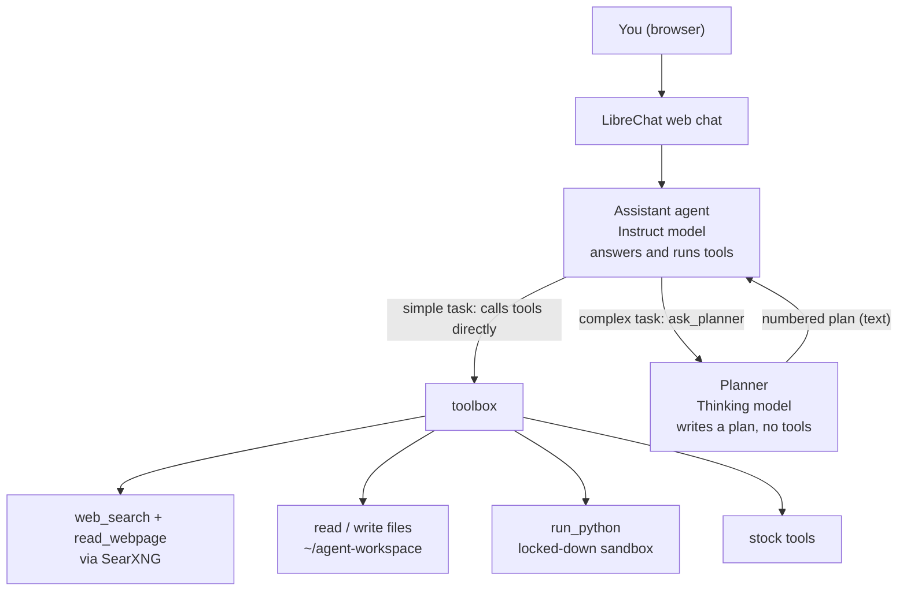

# local-ai-agent

A **100% self-hosted, open-source AI agent** for an ordinary home computer: a mini PC,
an old desktop, a home server or a laptop. **No graphics card required.**

It gives you a private ChatGPT-style web app whose AI can **search the web, read pages,
work with files, run Python in a sandbox, chat with your documents, and analyse
stocks**, and you can teach it new skills with a few lines of Python.

Nothing is sent to an AI company. The only outside traffic is the web searches, page
downloads and market data your agent asks for.

> **New to this?** Follow **[docs/GUIDE.md](docs/GUIDE.md)**. It's written for
> beginners, with copy-paste commands for every step.

## Requirements

| | Minimum | Recommended |
|---|---|---|
| OS | Ubuntu 22.04+ / Debian 12+ (64-bit) | Ubuntu LTS |
| CPU | x86-64 with AVX2, or ARM64 | 6+ cores |
| RAM | 8 GB | 32–64 GB |
| Disk | 20 GB free | 60 GB+ SSD |
| GPU | Not needed | NVIDIA/AMD speeds things up; Ollama uses it automatically |

## Models

`scripts/02_download_models.sh` picks and downloads all models automatically, based on your RAM:

| Your RAM | Agent model (runs tools) | Planner model (thinks) | Total download | Disk to have free |
|---|---|---|---|---|
| **50 GB or more** | `qwen3:30b-a3b-instruct-2507-q4_K_M` (19 GB) | `qwen3:30b-a3b-thinking-2507-q4_K_M` (19 GB) | ~41 GB | 60 GB |
| **28–49 GB** | `qwen3:30b-a3b-instruct-2507-q4_K_M` (19 GB) | `qwen3:4b-thinking-2507-q4_K_M` (2.5 GB) | ~25 GB | 40 GB |
| **8–27 GB** | `qwen3:4b-instruct-2507-q4_K_M` (2.5 GB) | `qwen3:4b-thinking-2507-q4_K_M` (2.5 GB) | ~6 GB | 20 GB |

Every machine also gets two small helper models (included in the totals above):
`qwen3:4b-instruct-2507-q4_K_M` (2.5 GB) for quick questions and chat titles, and
`nomic-embed-text` (0.3 GB) for searching your documents.

**Why two kinds of model?** Qwen3 comes in two flavours. *Instruct* models answer
directly and call tools reliably. *Thinking* models reason more carefully, but they often
plan a tool call in their hidden thoughts and then stop without making it, and the long
reasoning is slow on a CPU. So the agent you chat with uses an **Instruct** model, and it
asks a **Thinking** model for a plan only when a task is complex (the `ask_planner` tool).

The 30B models are *mixture-of-experts*: 30B parameters, but only ~3B are used per token,
so they run at usable speed on a CPU. Override any choice in `config/models.env`
(copy `config/models.env.example`).

## How a request flows



## Architecture (components)

```
  Browser (any device at home)
        │  http://<host>:3080
        ▼
  ┌──────────────┐      ┌─────────────────────────────┐
  │  LibreChat   │─────▶│  Ollama (on the host)       │
  │  (Docker)    │      │  Instruct: agent + fast     │
  │  chat UI,    │      │  Thinking: planner          │
  │  agents, RAG │      │  nomic-embed-text           │
  └──────┬───────┘      └──────────────▲──────────────┘
         │                             │
         │ MCP (streamable HTTP, Docker bridge only)
         ▼
  ┌─────────────────────────────────────────────────────┐
  │  toolbox  (Python MCP server, systemd service)      │
  │  current_datetime · web_search · read_webpage       │
  │  list_files · read_file · write_file                │
  │  run_python ──▶ agent-sandbox container             │
  │                  (no network, read-only, no caps)   │
  │  stock_price_summary · stock_indicators ·           │
  │  stock_fundamentals                                 │
  │  ask_planner ──▶ Thinking model in Ollama ──────────┘
  └──────┬──────────────────────────────────────────────┘
         │
         ▼
  SearXNG (Docker, localhost only) ──▶ public search engines
```

| Component | Role | License |
|---|---|---|
| [Ollama](https://github.com/ollama/ollama) | Runs the models | MIT |
| [LibreChat](https://github.com/danny-avila/LibreChat) | Web UI, agents, document chat | MIT |
| [SearXNG](https://github.com/searxng/searxng) | Private meta-search engine | AGPL-3.0 |
| [MCP Python SDK](https://github.com/modelcontextprotocol/python-sdk) | Tool server protocol | MIT |
| [Qwen3](https://huggingface.co/Qwen) | Open-weight models | Apache-2.0 |
| yfinance, pandas, httpx, BeautifulSoup | Tools | Apache-2.0 / BSD / MIT |

The models are *open-weight* (free to download and use; training data not public).
Market data comes from Yahoo Finance via yfinance.

## Design choices for modest hardware

- **Model sized to RAM**, preferring a mixture-of-experts model when memory allows:
  it has the knowledge of a large model at the speed of a small one.
- **Tools do the maths.** Small local models make arithmetic mistakes, so tools return
  computed numbers and the model only reasons about them.
- **Short tool outputs.** On a CPU, reading long prompts is the slow part, so every tool
  truncates and summarises.
- **16k context.** A balance between memory for multi-step tasks and speed.

## Quick start (if you've done this before)

```bash
git clone https://github.com/rahulkthakar/local-ai-agent.git ~/ai-kit
cd ~/ai-kit
bash scripts/00_check_hardware.sh      # read-only
bash scripts/01_install_base.sh        # then log out and back in
bash scripts/02_download_models.sh
bash scripts/03_searxng.sh
bash scripts/04_toolbox.sh
bash scripts/05_librechat.sh
bash scripts/check.sh
```

Open `http://localhost:3080`, sign up, and create an agent with the `toolbox` MCP
server and the instructions in [`config/agent-instructions.md`](config/agent-instructions.md)
(details: [GUIDE step 8](docs/GUIDE.md#step-8--create-your-general-purpose-agent)).

## Repository layout

```
scripts/        install, check, update, uninstall (run in order 00 → 05)
toolbox/        the MCP server with all agent tools
sandbox/        Dockerfile for the isolated Python sandbox
config/         LibreChat, SearXNG, model and agent-instruction templates
docs/           beginner guide and how to add tools
examples/       stand-alone minimal agent + prompts to try
tests/          unit tests (no network/Docker/Ollama needed)
runtime/        created at install time; git-ignored (LibreChat, venv, secrets)
```

## Security model

- **Toolbox** listens only on the Docker bridge address (not your LAN) and rejects
  unexpected `Host` headers.
- **SearXNG** listens on `127.0.0.1` only.
- **Code** written by the agent runs in a container with no network, a read-only
  filesystem, all capabilities dropped, and memory/CPU/process limits. It can only see
  the workspace folder.
- **Files**: the agent can only read and write `~/agent-workspace`.
- **Ollama and LibreChat** are reachable on your home network. Never port-forward them
  to the internet. Disable sign-ups after creating your account (see the guide).
- **Web pages are untrusted**: content is labelled, and the agent instructions tell
  the model not to follow instructions found in it. No defence against prompt
  injection is perfect, so don't give a web-browsing agent dangerous tools.

## Development

```bash
python3 -m venv .venv && . .venv/bin/activate
pip install -r toolbox/requirements.txt -r requirements-dev.txt
pytest -q && ruff check . && shellcheck -x scripts/*.sh
```

CI runs the same checks plus a sandbox image build on every push.
To add a skill, see [docs/ADDING_TOOLS.md](docs/ADDING_TOOLS.md).

## Disclaimer

Stock tools are for research and learning. AI output can be wrong. **Not financial advice.**

## License

[MIT](LICENSE)
