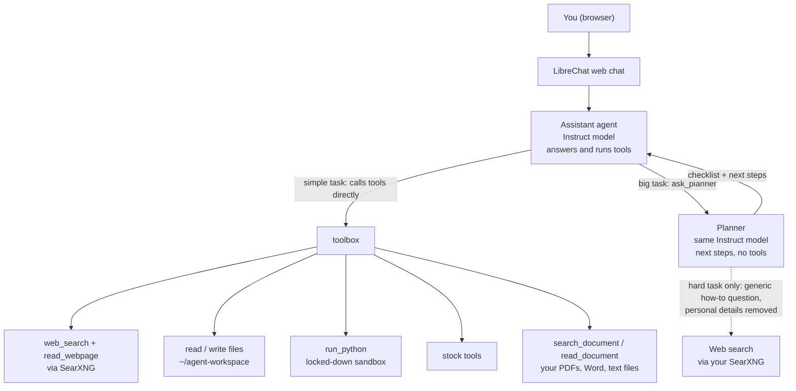
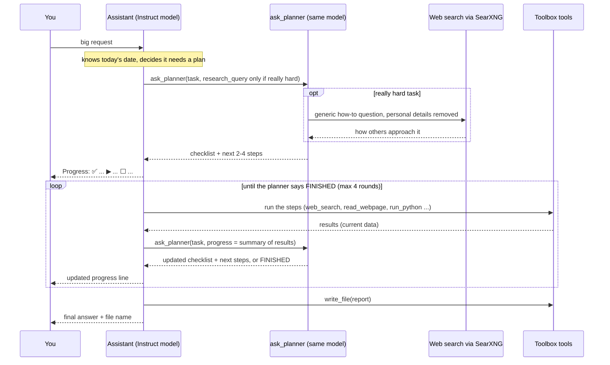

<p align="center"></p>

# Dhoon

**Website: [dhoon.knowreva.com](https://dhoon.knowreva.com)**

*Dhoon comes from the Hindi धुन (dhun): the inner spark, the drive that keeps going until the
work is done. Dhoon is an AI assistant with that drive, running privately on your own computer.*

A **100% self-hosted, open-source AI agent** for an ordinary home computer: a mini PC,
an old desktop, a home server or a laptop. **No graphics card required.**

It gives you a private ChatGPT-style web app whose AI can **search the web, read pages,
work with files, run Python in a sandbox, answer questions about your PDFs, Word and Excel
files, make Excel and Word reports, analyse stocks, check the weather, manage your calendar,
do tasks on a schedule, e-mail you the results and remember what you tell it about
yourself**, and you can teach it new skills with a few lines of Python.

Nothing is sent to an AI company. The only outside traffic is the web searches, page
downloads, market data and weather your agent asks for, and the calendars you connect.

**Install with one command** (Ubuntu/Debian, run as your normal user):

```bash
curl -fsSL https://dhoon.knowreva.com/install.sh | bash
```

It runs the whole setup, including creating the agent, and asks only for your password
and a login for the web app. Then open `http://localhost:3080`. Re-run the same command
to resume: it checks each step (`scripts/status.sh`) and skips what's already done, so it
also continues an install you started by hand. If a step fails it stops and shows the exact
command to run and fix that step by hand, then you re-run the installer.

> **New to this?** Follow **[docs/GUIDE.md](docs/GUIDE.md)**. It's written for
> beginners, with copy-paste commands for every step.

**Optional settings** (e-mail, calendars, your own models, encrypted backup, locking sign-up):
see [After installing: your settings](docs/GUIDE.md#after-installing-your-settings).

## Requirements

| | Minimum | Recommended |
|---|---|---|
| OS | Ubuntu 22.04+ / Debian 12+ (64-bit) | Ubuntu LTS |
| CPU | x86-64 with AVX2, or ARM64 | 6+ cores |
| RAM | 8 GB | 32–64 GB |
| Disk | 15 GB free | 35 GB+ SSD |
| GPU | Not needed | NVIDIA/AMD speeds things up; Ollama uses it automatically |

## Models

`scripts/02_download_models.sh` picks and downloads all models automatically, based on your RAM:

| Your RAM | Agent model (runs tools and plans) | Total download | Disk to have free |
|---|---|---|---|
| **28 GB or more** | `qwen3:30b-a3b-instruct-2507-q4_K_M` (19 GB) | ~22 GB | 35 GB |
| **8–27 GB** | `qwen3:4b-instruct-2507-q4_K_M` (2.5 GB) | ~3 GB | 15 GB |

Every machine also gets two small helper models (included in the totals above):
`qwen3:4b-instruct-2507-q4_K_M` (2.5 GB) for quick questions and chat titles, and
`nomic-embed-text` (0.3 GB) for searching your documents (`search_document`).

**Only *Instruct* models.** Qwen3 also comes as *Thinking* models, but on a CPU their long
hidden reasoning is slow, and they often plan a tool call in their thoughts and then stop
without making it. So everything here (chatting, running tools and planning big tasks)
uses the fast **Instruct** model. For really hard tasks, the planner can look up on the
web how such a task is usually done (see below), which helps more than slow thinking.

The 30B models are *mixture-of-experts*: 30B parameters, but only ~3B are used per token,
so they run at usable speed on a CPU. Override any choice (models, context window, keep-alive, research engines) in
`config/models.env` (copy `config/models.env.example`); see
[Choosing different models and settings](docs/GUIDE.md#choosing-different-models-and-settings).

## How a request flows



### Planning big tasks in rounds

Small requests are answered directly. Big ones are planned in short rounds, all by the
same local Instruct model:

1. **The Assistant reads your request and decides**, like a database query optimizer
   picking the cheapest plan: if it needs only 1–2 tool calls, it does them straight away
   and answers. If it needs 3 or more, several sources, a comparison or a report, it plans
   in rounds. You can override it: say *"plan this"* to force planning, or *"quick, no
   planning"* to skip it. It always knows today's date.
2. **`ask_planner` gives the next few steps**: a progress checklist and only the next 2–4
   steps (each naming a tool). One quick call, no slow "thinking".
3. **The Assistant carries out those steps** with its tools, then calls `ask_planner`
   again with a short summary of the results. The planner adjusts the plan or says
   **FINISHED** (at most 4 rounds). After each round the Assistant posts a one-line
   progress checklist in the chat, e.g. `Progress: ✅ Research · ▶ Scoring · ⬜ Report`.
4. **The Assistant writes the final answer.**

Anything that can change (prices, versions, news, laws, market data) is checked with
tools, not taken from the model's memory.

### Really hard tasks: research how to approach it

For a really hard or unfamiliar task (or when you say *"research how to do this first"*),
round 1 of `ask_planner` first searches the web, through your own SearXNG, for how such a
task is usually done, and plans with those ideas. Privacy:

- Only a short, **generic** how-to question is sent, written by the Assistant, e.g.
  *"how to compare open source backup tools for linux"*. Your request, files and chat
  are never sent.
- The toolbox also removes personal details from that question before it leaves your
  computer: e-mail addresses, links, IP addresses, file paths and names, money amounts,
  phone and account numbers, and your computer's user and host names.
- The Assistant tells you the exact query that was searched.
- The search engines see that question and your internet address, like any search you
  make, but no cookies, account or chat history.

**Choosing the search engines.** By default it uses the engines your SearXNG normally
uses. To choose your own, add a line to `config/models.env`, then run
`bash scripts/04_toolbox.sh`:

```bash
RESEARCH_ENGINES="startpage,duckduckgo,brave"
```

All of these are free and need no account:

| Engine | Name | Good for |
|---|---|---|
| Startpage | `startpage` | Google's results without Google seeing you directly |
| DuckDuckGo | `duckduckgo` | Private, no tracking |
| Brave Search | `brave` | Own index, private |
| Mojeek | `mojeek` | Small independent index, no tracking |
| Google / Bing | `google`, `bing` | Biggest indexes (Google sometimes blocks automated searches) |
| Wikipedia | `wikipedia` | Background on a topic |
| Stack Overflow / Ask Ubuntu | `stackoverflow`, `askubuntu` | Technical how-to tasks |

Use several: their results are merged, and if one blocks you the others still answer.
If the chosen engines find nothing, the toolbox retries once with all engines.



Try it with the Level 7 example in the guide: [Step 9](docs/GUIDE.md#step-9--practise-from-easy-to-hard).

## Architecture (components)

```
  Browser (any device at home)
        │  http://<host>:3080
        ▼
  ┌──────────────┐      ┌─────────────────────────────┐
  │  LibreChat   │─────▶│  Ollama (on the host)       │
  │  (Docker)    │      │  Instruct: agent + fast     │
  │  chat UI,    │      │  (also plans big tasks)     │
  │  agents, RAG │      │  nomic-embed-text           │
  └──────┬───────┘      └──────────────▲──────────────┘
         │                             │
         │ MCP (streamable HTTP, Docker bridge only)
         ▼
  ┌─────────────────────────────────────────────────────┐
  │  toolbox  (Python MCP server, systemd service)      │
  │  current_datetime · web_search · read_webpage       │
  │  list_files · read_file · write_file                │
  │  run_python ──▶ agent-sandbox container             │
  │                  (no network, read-only, no caps)   │
  │  stock_price_summary · stock_indicators ·           │
  │  stock_fundamentals · stock_save_history (CSV)      │
  │  send_email (your SMTP account, allow-listed)       │
  │  weather (Open-Meteo) · calendar_events ·           │
  │  calendar_add_event · calendar_delete_event         │
  │  schedule_task · scheduled_tasks ·                  │
  │  cancel_scheduled_task (run by ai-scheduler timer)  │
  │  search_document · read_document (PDF/Word/text,    │
  │    embedded with nomic-embed-text in Ollama)        │
  │  ask_planner ──▶ Instruct model in Ollama ──────────┘
  └──────┬──────────────────────────────────────────────┘
         │
         ▼
  SearXNG (Docker, localhost only) ──▶ public search engines
```

LibreChat's requests to Ollama go through the toolbox (`/ollama/`, passed on unchanged), which
keeps a copy of the Assistant's instructions so they can be read in advance (fast first answer).

| Component | Role | License |
|---|---|---|
| [Ollama](https://github.com/ollama/ollama) | Runs the models | MIT |
| [LibreChat](https://github.com/danny-avila/LibreChat) | Web UI, agents, document chat | MIT |
| [SearXNG](https://github.com/searxng/searxng) | Private meta-search engine | AGPL-3.0 |
| [MCP Python SDK](https://github.com/modelcontextprotocol/python-sdk) | Tool server protocol | MIT |
| [Qwen3](https://huggingface.co/Qwen) | Open-weight models | Apache-2.0 |
| yfinance, pandas, httpx, BeautifulSoup | Tools | Apache-2.0 / BSD / MIT |

The models are *open-weight* (free to download and use; training data not public).
Market data comes from Yahoo Finance via yfinance.

## After a reboot

Everything starts by itself: Docker, Ollama (and the main model is loaded into memory),
SearXNG, LibreChat and the toolbox with your plugins. Scheduled jobs keep their times, and a
job missed while the computer was off runs shortly after it starts. Give it 2-3 minutes after
boot; `bash scripts/check.sh` confirms. If something is stuck, `bash scripts/restart.sh`
restarts every part in order and runs the check, with no reboot needed. Details: "After a
reboot" in [docs/GUIDE.md](docs/GUIDE.md).

## Logs: finding out why a chat stopped

```bash
bash scripts/logs.sh            # last 60 minutes, from every part, with a diagnosis
bash scripts/logs.sh --follow   # watch live while you chat
```

Every tool call is logged with its inputs, time taken and result or error
(`runtime/logs/toolbox.log`). The script adds the warnings from Ollama (for example when
a chat outgrew the context window), LibreChat and SearXNG, and says what they mean.
Details: [Troubleshooting in the guide](docs/GUIDE.md#troubleshooting).

## Design choices for modest hardware

- **Tested versions only.** The chat website and the search engine are pinned to the exact
  versions Dhoon was tested with (`LIBRECHAT_REF` and `SEARXNG_IMAGE` in `scripts/lib.sh`,
  LibreChat's images in `config/librechat/docker-compose.override.yml`), so a change upstream
  can't break an install. `scripts/update.sh` keeps them there; moving to newer versions is a
  deliberate, tested release.

- **Main model pinned in memory** (28+ GB RAM): `OLLAMA_KEEP_ALIVE=-1` plus an
  `ai-model-preload` service that loads it whenever Ollama starts, so answers never wait
  for the 19 GB model to load again. Change with `KEEP_ALIVE` in `config/models.env`.
- **Model sized to RAM**, preferring a mixture-of-experts model when memory allows:
  it has the knowledge of a large model at the speed of a small one.
- **Tools do the maths.** Small local models make arithmetic mistakes, so tools return
  computed numbers and the model only reasons about them.
- **Short tool outputs.** On a CPU, reading long prompts is the slow part, so every tool
  truncates and summarises.
- **Two agents.** The full *Assistant* has every tool; the *Quick Assistant* has only the
  everyday ones (weather, calendar, reminders, web search, e-mail) and short instructions:
  about 1,400 tokens to read instead of 4,500, so it answers sooner and picks tools better.
- **Lean web pages.** Only the article text of a page is kept (trafilatura, locally), not
  menus, footers or "related stories": fewer words for the model to read.
- **Instructions read in advance.** Before each new chat the model must read ~4,500 tokens
  of instructions and tool descriptions (minutes on a CPU). Ollama remembers what it read, so
  the instructions stay identical all day (date only, no clock time), tool descriptions are
  trimmed, and the toolbox (which passes the chat website's requests to Ollama) keeps a copy
  that `scripts/preload_model.sh` has the model read after Ollama starts, after midnight and
  after nightly jobs. New chats then start answering in seconds.
- **32k context with 28+ GB RAM (16k otherwise).** Big tasks (web pages, stock data, a
  report) need ~20k tokens; when the chat doesn't fit, the model loses your request.
- **CPU vs GPU is measured, not guessed.** `scripts/benchmark.sh` compares Ollama's default
  (GPU if supported) with CPU only and keeps the faster one. On a mini PC with Intel UHD
  integrated graphics, CPU only was about 2× faster at both reading and writing.

## Step-by-step install (what the one-command installer does)

```bash
git clone https://github.com/dhoon-ai/dhoon.git ~/dhoon
cd ~/dhoon
bash scripts/00_check_hardware.sh      # read-only
bash scripts/01_install_base.sh        # then log out and back in
bash scripts/02_download_models.sh
bash scripts/03_searxng.sh
bash scripts/04_toolbox.sh
bash scripts/05_librechat.sh
bash scripts/06_create_agent.sh        # creates the Assistant agent (asks for a login)
bash scripts/check.sh
bash scripts/benchmark.sh              # optional: keeps CPU-only if that's faster here
```

Then open `http://localhost:3080` and pick **Agents → Assistant**. Script 06 sets the agent
up with the main Instruct model, every toolbox tool, File Search, the instructions in
[`config/agent-instructions.md`](config/agent-instructions.md) and some starter prompts
([manual way](docs/GUIDE.md#step-8--create-your-general-purpose-agent)).

**Documents:** either copy a file into `~/agent-workspace` and mention its name (toolbox
`search_document`), or upload it in the Agent Builder under **File Search** and select it
with **+** in the chat. See [Ask questions about your documents](docs/GUIDE.md#ask-questions-about-your-documents).

## Repository layout

```
CHANGELOG.md    what changed in each release
install.sh      one-command installer (runs scripts 00 → 06)
assets/         the Dhoon logo, the agents' pictures and the scripts that draw them
scripts/        install steps 00 → 06, status, check, logs, Ollama settings + model preload,
                benchmark, unban, update, restart, uninstall, encrypted backup + restore
toolbox/        the MCP server: toolbox_server.py (core) + toolset/ (the tools, one file per
                job: everyday, web, files, documents, planner, stocks, mail), calendars,
                weather, scheduler, warm-up, e-mail
plugins/        your private add-on tools (git-ignored, see plugins/README.md)
sandbox/        Dockerfile for the isolated Python sandbox
config/         LibreChat (with the Dhoon icons in config/branding), SearXNG, model and
                agent-instruction templates
docs/           beginner guide and how to add tools
examples/       stand-alone minimal agent + prompts to try
site/           the Dhoon website, published with install.sh by GitHub Pages (.github/workflows/pages.yml)
tests/          unit tests (no network/Docker/Ollama needed)
runtime/        created at install time; git-ignored (LibreChat, venv, secrets)
```

## Security model

- **Toolbox** listens only on the Docker bridge address (not your LAN) and rejects
  unexpected `Host` headers.
- **SearXNG** listens on `127.0.0.1` only.
- **Code** written by the agent runs in a container with no network, a read-only
  filesystem, all capabilities dropped, and memory/CPU/process limits. It can only see
  the workspace folder.
- **Files**: the agent can only read and write `~/agent-workspace`.
- **Ollama and LibreChat** are reachable on your home network. Never port-forward them
  to the internet. Disable sign-ups after creating your account (see the guide).
- **Web research for hard tasks** sends only a short, generic how-to question; e-mails,
  links, IPs, file paths and names, amounts, long numbers and your user/host names are
  removed first, and the agent shows you the exact query.
- **E-mail** goes only to the addresses you allow in `config/email.env` (default: yourself),
  with workspace files only and a daily limit; the file is never committed.
- **Backups** (optional, `scripts/backup.sh`) are encrypted with age on your computer, to
  an offline recovery key and optionally a YubiKey, before they go to your private git repo.
- **Calendars** you connect keep their passwords and tokens in `config/calendar.env` and
  `runtime/google_token.json`, readable only by you; Google access is limited to calendar
  events. The agent adds or deletes events only when you ask.
- **Scheduled tasks** are stored outside the workspace (so nothing the agent reads or writes
  can add one) and run unattended without the tools that send e-mail, change calendars,
  record investments or schedule more tasks. Results go only to your own inbox.
- **Logs stay local**: tool calls are logged to `runtime/logs/toolbox.log` on your computer.
- **Web pages are untrusted**: content is labelled, and the agent instructions tell
  the model not to follow instructions found in it. No defence against prompt
  injection is perfect, so don't give a web-browsing agent dangerous tools.

## Development

```bash
python3 -m venv .venv && . .venv/bin/activate
pip install -r toolbox/requirements.txt -r requirements-dev.txt
pytest -q && ruff check . && shellcheck -x scripts/*.sh
```

CI runs the same checks plus a sandbox image build on every push.

## Uninstall

`bash scripts/uninstall.sh` removes the services and keeps your data; `--everything` also
deletes chats, files and models; `--purge` additionally uninstalls Ollama and Docker. Each
asks for confirmation, and `DRY_RUN=1` previews. See
[Uninstall and start over](docs/GUIDE.md#uninstall-and-start-over).
To add a skill, see [docs/ADDING_TOOLS.md](docs/ADDING_TOOLS.md).

## Credits

Built on these open-source projects and free services. Everything runs on your computer
except the services marked *(online)*, which receive only the request itself (a search, a
page address, a place name, a ticker), never your chats or files.

| Project | What it does here | Licence |
|---|---|---|
| [Ollama](https://ollama.com) | runs the AI models | MIT |
| [Qwen3](https://github.com/QwenLM/Qwen3) (Alibaba Qwen team) | the language models | Apache-2.0 |
| [nomic-embed-text](https://huggingface.co/nomic-ai/nomic-embed-text-v1.5) | text embeddings for document search | Apache-2.0 |
| [LibreChat](https://www.librechat.ai) | the chat website and agents | MIT |
| [SearXNG](https://github.com/searxng/searxng) | private web search (queries public engines *(online)*) | AGPL-3.0 |
| [Docker](https://www.docker.com) | containers for LibreChat, SearXNG and the Python sandbox | Apache-2.0 |
| [MCP Python SDK](https://github.com/modelcontextprotocol/python-sdk) | the tool server protocol | MIT |
| [trafilatura](https://github.com/adbar/trafilatura) | the article text of web pages | Apache-2.0 |
| [Beautiful Soup](https://www.crummy.com/software/BeautifulSoup/) | reading HTML | MIT |
| [HTTPX](https://www.python-httpx.org) | web requests | BSD-3-Clause |
| [pypdf](https://github.com/py-pdf/pypdf), [python-docx](https://github.com/python-openxml/python-docx), [openpyxl](https://openpyxl.readthedocs.io) | reading and writing PDF, Word and Excel files | BSD-3-Clause, MIT, MIT |
| [rank-bm25](https://github.com/dorianbrown/rank_bm25) | keyword search in documents | Apache-2.0 |
| [pandas](https://pandas.pydata.org), [NumPy](https://numpy.org), [Matplotlib](https://matplotlib.org) | numbers and charts (also in the sandbox) | BSD-3-Clause, BSD-3-Clause, Matplotlib (PSF-based) |
| [yfinance](https://github.com/ranaroussi/yfinance) | market data from Yahoo Finance *(online; Yahoo's terms: personal use)* | Apache-2.0 |
| [Python-Markdown](https://python-markdown.github.io) | e-mails in HTML | BSD-3-Clause |
| [icalendar](https://github.com/collective/icalendar), [recurring-ical-events](https://github.com/niccokunzmann/python-recurring-ical-events), [caldav](https://github.com/python-caldav/caldav) | calendars | BSD-2-Clause, LGPL-3.0-or-later, Apache-2.0 / GPL-3.0 |
| [Open-Meteo](https://open-meteo.com) | weather forecasts *(online)*, data under CC BY 4.0 | free API |
| [age](https://age-encryption.org), [age-plugin-fido2-hmac](https://github.com/olastor/age-plugin-fido2-hmac) | encrypting backups (YubiKey optional) | BSD-3-Clause, MIT |
| [Resend](https://resend.com), [Brevo](https://www.brevo.com) | optional e-mail sending over HTTPS *(online)* | services |
| [CairoSVG](https://cairosvg.org) | draws the icon files from the logo (only when you re-make them) | LGPL-3.0 |

Thank you to everyone who builds and maintains them. Dhoon uses LibreChat as its chat
website and shows its own name and icons there; LibreChat's name and logo belong to its authors.

## Disclaimer

Stock tools are for research and learning. AI output can be wrong. **Not financial advice.**

## License

[MIT](LICENSE). Dhoon is one of the projects shown on [KnowReva](https://knowreva.com).
